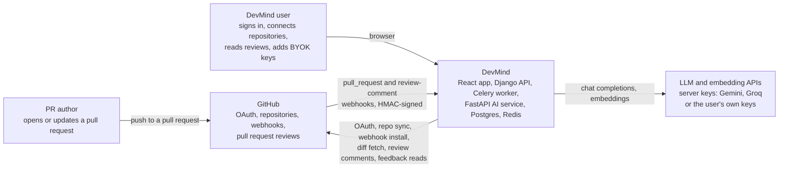
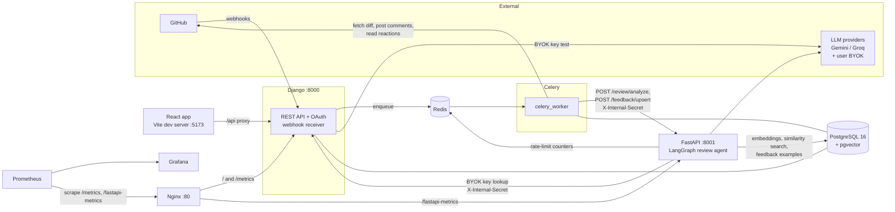

# DevMind

[](https://github.com/muhammedsiinanmp/Devmind/actions/workflows/ci.yml)
[](LICENSE)

DevMind is an AI pull-request reviewer for GitHub. When a pull request is opened or updated, a Celery worker fetches the diff and sends it to a FastAPI service. There a LangGraph agent runs three LLM analyzers in parallel (security, quality, tests) over the changed files, with similar code from the same repository retrieved from pgvector as context. Each finding is checked against the diff's line numbers, and the findings are posted back to the pull request as one `COMMENT` review with inline comments. Users can add their own LLM API keys, which are tried before the server's providers, and verdicts from trusted developers on earlier comments are shown to later reviews of the same repository ([docs/feedback-learning.md](docs/feedback-learning.md)). A React dashboard lists reviews with a diff viewer.

## Review quality

The eval harness in `backend/fastapi/evals/` runs the review agent on 27 hand-written synthetic diffs (9 clean, 18 with one labeled defect each) and scores the posted findings against the labels. The method, metrics and run provenance are in [docs/evals.md](docs/evals.md).

The table compares the agent before the A-series fixes with the agent after them. Both runs used `groq/openai/gpt-oss-120b` for every model call, and each side is a single live run. The table is the output of `scripts/eval_compare.py` on [`baseline-pre-fix.json`](backend/fastapi/evals/results/baseline-pre-fix.json) and [`after-fixes.json`](backend/fastapi/evals/results/after-fixes.json), and a test (`tests/test_eval_compare.py`) checks that it still matches them.

| Metric | Before (pre-fix) | After (dev) | Change |
|---|---|---|---|
| Recall, exact line | 0.556 (10/18) | 1.000 (18/18) | +0.444 |
| Precision, exact location | 0.066 (10/152) | 0.281 (18/64) | +0.215 |
| Precision, duplicates collapsed | 0.081 (10/123) | 0.300 (18/60) | +0.219 |
| Precision, location-tolerant | 0.112 (17/152) | 0.281 (18/64) | +0.169 |
| Recall, location-tolerant | 0.944 (17/18) | 1.000 (18/18) | +0.056 |
| False-positive rate on clean diffs | 1.000 (9/9) | 1.000 (9/9) | no change |
| Findings on clean diffs | 42 | 16 | -26 |
| Findings on clean diffs at critical or error severity | 1 | 0 | -1 |
| Findings posted | 152 | 64 | -88 |
| Valid-line rate (agent output, before anchoring) | 0.914 (139/152) | 1.000 (64/64) | +0.086 |
| Analyzer parse failures | not reported by this code | 0 | n/a |
| Anchoring (anchored / snapped / file-level) | not applied | 64 / 0 / 0 | n/a |
| Cases scored | 27 of 27 | 27 of 27 | no change |

What it shows:
- **Recall.** After the fixes, all 18 labeled defects get a finding on the labeled line, compared with 10 before.
- **Precision is still low.** 46 of the 64 posted findings match no label. A real issue nobody labeled also counts as an extra, so precision is a lower bound.
- **Clean diffs.** Every clean diff still gets at least one comment (9 of 9 in both runs). There are fewer of them (16, down from 42), and none is critical or error.
- **Latency isn't compared.** The before run's times may include failed Google calls before failover to Groq ([details](docs/evals.md#reading-the-beforeafter-table)).
- **Scope.** 27 synthetic diffs. The numbers describe what this agent and model did on these cases, not performance on real pull requests.

**Run-to-run variance.** The model's output isn't deterministic, so two live runs of the same code differ. A second live run of unchanged `dev` (commit `9dd6824`, before #107) is in [`dev-rerun.json`](backend/fastapi/evals/results/dev-rerun.json). Its prompts are the after run's: the after run's cassettes replay on `9dd6824` with no missing recording and no metric change. It used `groq/openai/gpt-oss-120b` with `--provider groq --pause 75` (`run_flags` in the results file) and scored 23 of 27 cases; the last 4 errored with `AllProvidersDownError` when Groq's quota ran out. On the 23 cases both runs scored, `uv run python -m scripts.eval_noise evals/results/after-fixes.json evals/results/dev-rerun.json` prints:

```text
Cases scored in both runs: 23 of 27.

Cases whose output differs between the runs:
- per-case scores (findings, matched, near, partial, missed, extra): 11 of 23
- posted findings by file, line, category and severity: 18 of 23
- posted findings including the comment text: 22 of 23

| Over the 23 common cases | after-fixes.json | dev-rerun.json |
|---|---|---|
| exact matches | 14 | 14 |
| location-tolerant matches | 14 | 14 |
| findings posted | 59 | 58 |
| findings on clean diffs | 16 | 17 |
| clean diffs with a finding | 9 | 8 |
| findings on clean diffs at critical or error severity | 0 | 1 |

Cases with different scores: clean-docstring, clean-function-with-tests, clean-rename-variable, clean-test-only, clean-type-hints, go-ignored-error, missing-auth-check, missing-await, missing-test-for-new-branch, off-by-one-range, path-traversal
```

So on identical code about half the cases (11 of 23) changed their scores and 18 of 23 posted a different set of findings, while the totals moved by at most one: exact matches 14 in both runs, findings posted 59 and 58, findings on clean diffs 16 and 17, and 0 and 1 of them at critical or error severity. The before/after table above compares one run each; its large changes (exact matches 10 to 18, findings posted 152 to 64) are far bigger than the differences between these two runs, but a difference of a few findings between two single runs isn't evidence of a change. To measure one, record several runs per side with `--repeat 3` and compare them with `scripts/eval_compare.py`, which marks changes within noise. A test (`tests/test_eval_noise.py`) checks that the output above still matches the two results files.

**Current reference run: A7.** The per-review delimiter tag (#99, merged in #107) changed every prompt, so the after run's recordings no longer replay. The committed cassettes and the CI reference are now a live run of the A7 prompts, scored in [`after-a7.md`](backend/fastapi/evals/results/after-a7.md) and `.json`. On the same 27 cases it scored: recall, exact line 0.889 (16/18); recall, location-tolerant 1.000 (18/18); precision, exact location 0.235 (16/68); false-positive rate on clean diffs 1.000 (9/9); 20 findings on clean diffs, 1 of them at critical or error severity. Both are single runs, so read differences of a few findings between them against the run-to-run variance above.

**Feedback learning isn't shown to work yet.** Three extra cases in `evals/cases/feedback/` were recorded twice with and twice without rejected-comment examples ([`feedback-runs/`](backend/fastapi/evals/results/feedback-runs/)). In the control case, a real MD5 password bug was found as critical in all 4 runs, so a rejected "MD5 is weak" example didn't hide it. Suppression of false positives was not demonstrated: without feedback, the model didn't make the targeted mistakes either, so these cases can't measure it. Cases that can are tracked in #111. Details in [docs/feedback-learning.md](docs/feedback-learning.md#evals).

## Security design

Each line names the code that implements it. Detail and caveats: [docs/SYSTEM_ARCHITECTURE.md, Security Model](docs/SYSTEM_ARCHITECTURE.md#11-security-model).

- **Signed webhooks.** The `X-Hub-Signature-256` HMAC-SHA256 of the raw body is compared in constant time before the payload is dispatched, and every webhook is rejected with 403 when `GITHUB_WEBHOOK_SECRET` is empty (`backend/django/apps/repositories/webhooks.py`).
- **Encrypted tokens.** GitHub OAuth tokens and BYOK API keys are stored Fernet-encrypted with a key derived from `DJANGO_SECRET_KEY` by HKDF (`backend/django/apps/accounts/encryption.py`).
- **SSRF guard.** A user-supplied BYOK `base_url` must use https and resolve only to public addresses, checked on save and again before the key test (`backend/django/apps/accounts/url_safety.py`). DNS rebinding between check and use isn't prevented, and FastAPI calls the stored URL without re-checking it.
- **Internal secret.** FastAPI's `/review`, `/embeddings` and `/feedback` routes and Django's internal BYOK endpoint require `X-Internal-Secret`, compared in constant time, and refuse every request when the secret is empty (`backend/fastapi/core/security.py`).
- **Untrusted-data delimiters.** The diff, retrieved code and feedback examples are wrapped in `<untrusted_data_<nonce>>` tags with an 18-digit random nonce per review, the system prompt says their content is data, never instructions, and look-alike tags inside the content are escaped (`new_delimiter_tag` and `escape_untrusted` in `backend/fastapi/services/prompt_builder.py`). This lowers the risk of prompt injection from a pull request; it doesn't rule it out.
- **Feedback trust model.** Verdicts count only from the user who connected the repository (matched by GitHub id), the repository owner, and users with write or admin permission; never from bots or from the pull request's own author. A pull request's feedback is excluded from its own later reviews (`TrustChecker` in `backend/django/apps/reviews/services/feedback.py`, [ADR 0005](docs/adr/0005-feedback-trust-model.md)).
- **Single-use OAuth state.** The OAuth `state` is random, kept in Redis for 10 minutes and accepted once (`backend/django/apps/accounts/oauth.py`).

## Architecture

**Context.** Who and what DevMind talks to:



**Containers.** The processes inside DevMind and how they connect (Prometheus and Grafana start only with `make up-ops`):



A review moves through the system like this:

1. GitHub sends a `pull_request` webhook. Django verifies the signature and queues a Celery task.
2. The worker creates one `Review` per repository, PR number and head SHA (a redelivered webhook doesn't duplicate it), fetches the diff and calls FastAPI.
3. FastAPI embeds the changed hunks, retrieves similar code from the same repository (leaving out the PR's own chunks, [ADR 0002](docs/adr/0002-retrieval-excludes-own-pr.md)), skips generated files, splits a large diff into batches of whole files and runs the agent on each batch within a deadline ([ADR 0004](docs/adr/0004-review-deadline-partial-results.md)). Findings are anchored to diff lines.
4. The worker stores the comments and a summary ending in "Reviewed X of Y files", then a separate task posts them to GitHub. The dashboard polls for the status ([ADR 0003](docs/adr/0003-polling-instead-of-websockets.md)).

The deployment view (all eleven compose services), the review sequence, the agent, the data model and the remaining design decisions are in [docs/SYSTEM_ARCHITECTURE.md](docs/SYSTEM_ARCHITECTURE.md). Key decisions are recorded in [docs/adr/](docs/adr/).

## Quick start

Needs Docker with Compose v2 and a [GitHub OAuth App](https://github.com/settings/developers) whose callback URL is `http://localhost:5173/auth/callback`.

```bash
cp .env.example .env   # then set the values listed below
make up                # docker compose up -d: runs migrations, then starts the app stack
# open http://localhost:5173
```

In `.env`, set `DJANGO_SECRET_KEY`, `JWT_SECRET_KEY`, `FASTAPI_INTERNAL_SECRET`, `GITHUB_CLIENT_ID`, `GITHUB_CLIENT_SECRET`, `GITHUB_WEBHOOK_SECRET`, and at least one of `GOOGLE_AI_API_KEY` / `GROQ_API_KEY` (the Google key is also used for embeddings). `make up` starts Postgres, Redis, a one-shot `migrate` service, Django, FastAPI, the Celery worker, Nginx and the Vite frontend; `make up-ops` adds Flower, Prometheus and Grafana. To receive webhooks locally, run `make ngrok` and set `DEVMIND_PUBLIC_URL` to the tunnel URL; the compose stack runs Django with development settings (`DEBUG=True`, all hosts allowed), so expose it only briefly. Ports, every variable, tests and troubleshooting: [docs/ENGINEERING_GUIDE.md](docs/ENGINEERING_GUIDE.md).

## Checking providers and running evals

Both run on the host and need `uv`.

```bash
make providers-check   # one short chat request per keyed server provider, plus an embedding-dimension check
make eval              # replay the committed recordings offline: no keys, deterministic
make eval-record EVAL_ARGS="--provider groq --pause 75"   # live run: re-records cassettes, writes results
```

`make providers-check` prints each provider's model, whether it's listed, the result and latency, never prints keys, and exits non-zero if no provider answers or the embedding doesn't return 768 values. Replay re-scores recorded responses, so it can't measure a prompt change; that needs `make eval-record`. On pull requests that touch the agent or eval code, CI's `Evals (replay)` job replays the cassettes, compares the scores with `after-a7.json` and posts the result as a PR comment. More in [docs/evals.md](docs/evals.md) and [docs/ENGINEERING_GUIDE.md](docs/ENGINEERING_GUIDE.md#llm-providers-fastapi-set-at-least-one-or-configure-byok-keys).

## Known limitations

- **Review quality.** Every clean eval diff gets at least one comment, most posted findings match no label (46 of 64 in the after run), and the eval set is 27 synthetic diffs with single runs per side (see [Review quality](#review-quality)).
- **Feedback suppression is unmeasured** (#111).
- **Embedding tables are set up by hand.** `make up` enables the `vector` extension but creates neither `code_embeddings` (defined in `backend/fastapi/models/embeddings.py`) nor `feedback_embeddings`. Until `code_embeddings` exists and the SQL files in [`backend/fastapi/migrations/sql/`](backend/fastapi/migrations/sql/) are applied in order (`0004` creates `feedback_embeddings`), reviews run without retrieved code or feedback examples (logged, not fatal).
- **Unused prompt sections.** `review_embeddings` is never written and repository conventions are never loaded, so those prompt sections stay empty.
- **Secrets in the browser.** `GET /api/v1/auth/github/token/` returns the user's decrypted GitHub token, and the frontend keeps JWTs in `localStorage`.
- **Provider coverage.** Anthropic BYOK keys can be saved but aren't used, since the client only speaks the OpenAI-compatible `/chat/completions` API. When a provider's per-minute limit is full, the rate limiter waits for the next minute instead of failing over.
- **Reporting gaps.** Django stores zero token counts, and a review with no findings posts nothing to GitHub.
- **No deployment setup.** The repository has only the development compose file; there are no production manifests.
- **Frontend tests are minimal.** Vitest covers the status polling loop, the review page's load logic and the scan-removal check; there are no component tests.

The full list, with the embedding-migration caveats, is in [docs/ENGINEERING_GUIDE.md, Known Gaps](docs/ENGINEERING_GUIDE.md#10-known-gaps).

## Documentation

| Document | Contents |
|---|---|
| [docs/SYSTEM_ARCHITECTURE.md](docs/SYSTEM_ARCHITECTURE.md) | Services and topology, review flow, AI pipeline, data model, failure handling, security model, design trade-offs |
| [docs/ENGINEERING_GUIDE.md](docs/ENGINEERING_GUIDE.md) | Tech stack, environment variables, local setup, API reference, testing and CI, deployment notes, troubleshooting, known gaps |
| [docs/evals.md](docs/evals.md) | Eval harness, metrics, CI report, provenance of every committed run |
| [docs/feedback-learning.md](docs/feedback-learning.md) | What counts as accepted or rejected feedback, whose signals count, threat model, eval results |
| [docs/adr/](docs/adr/) | Architecture decision records |
| [frontend/README.md](frontend/README.md) | Frontend stack and scripts |
| [CONTRIBUTING.md](CONTRIBUTING.md) | Branches, pull requests, required CI checks |
| [SECURITY.md](SECURITY.md) | How to report a vulnerability |

## License

DevMind is released under the [MIT License](LICENSE).
