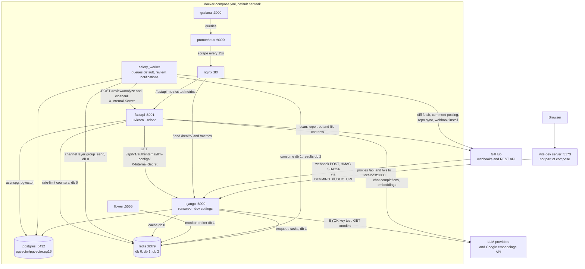
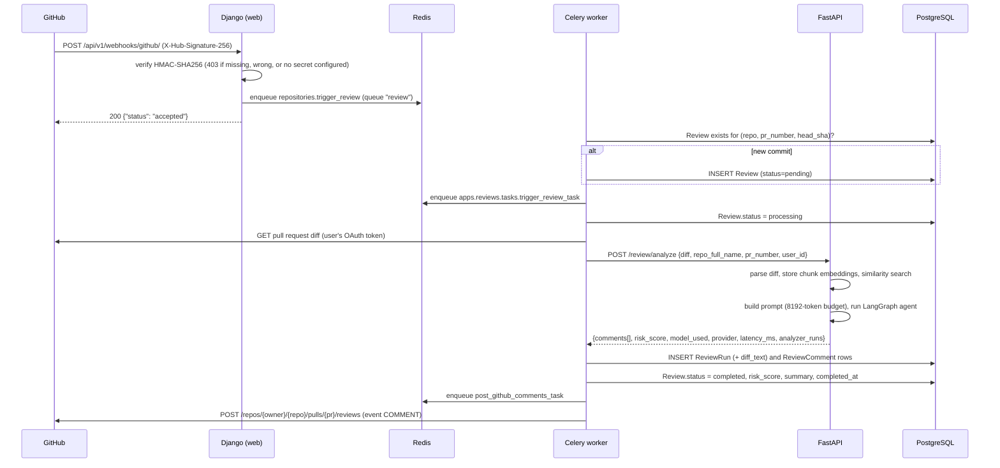
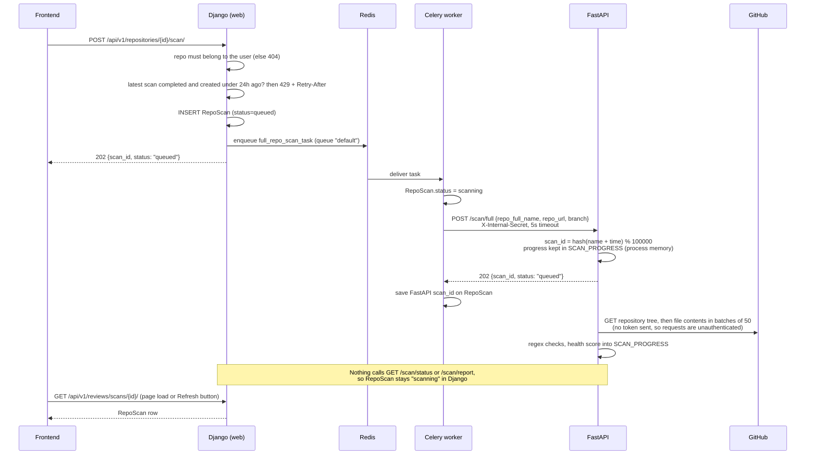
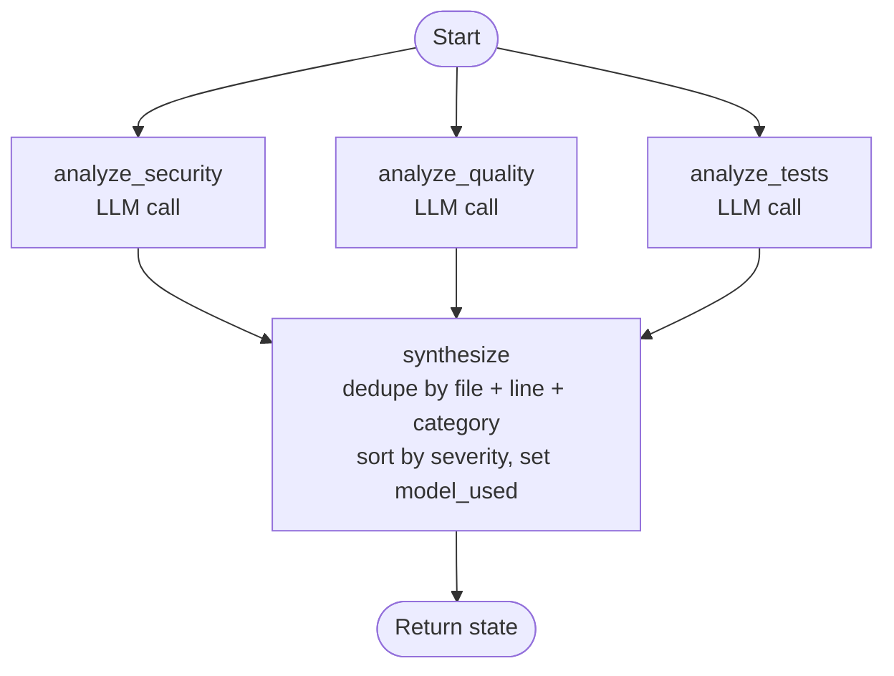
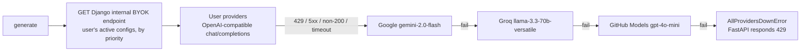
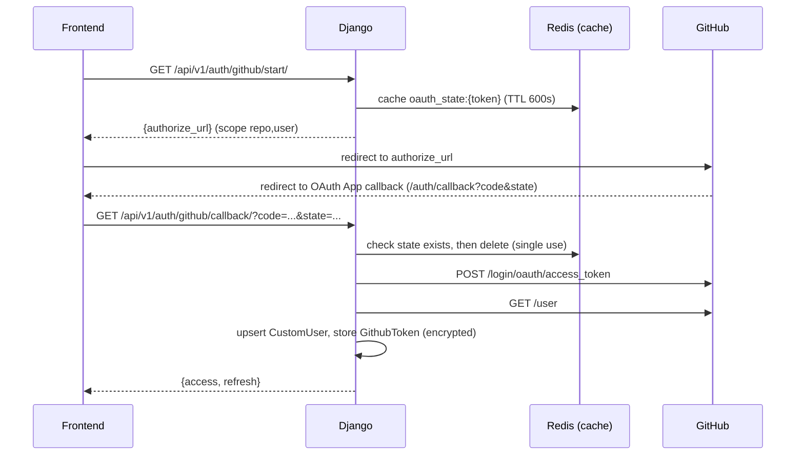
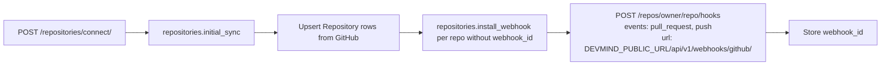
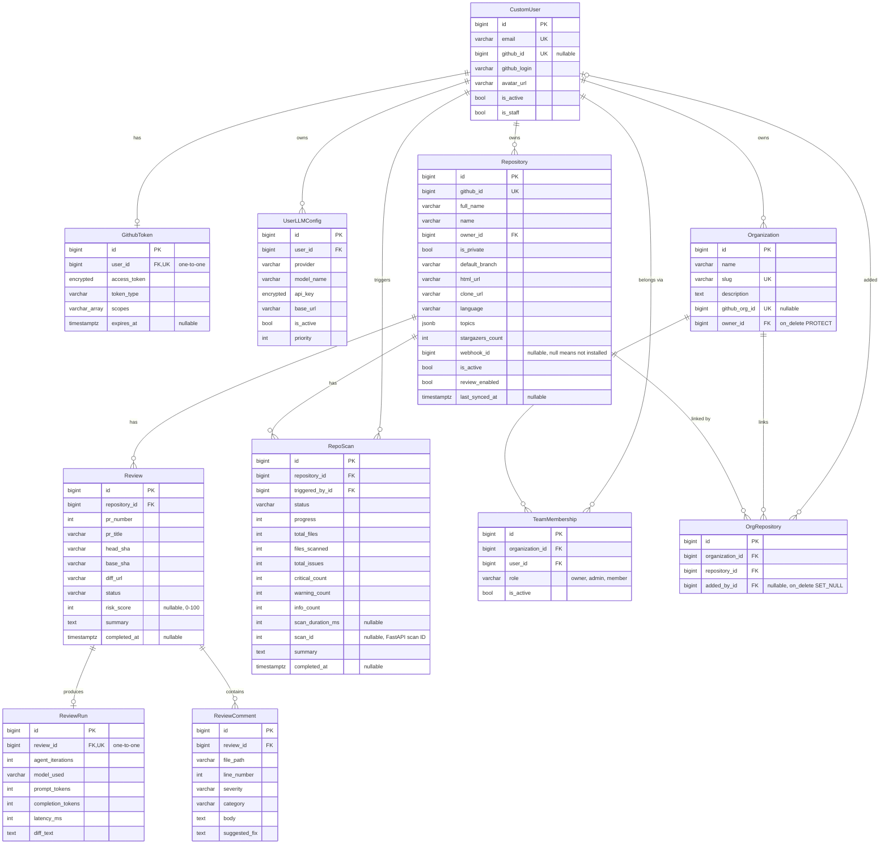
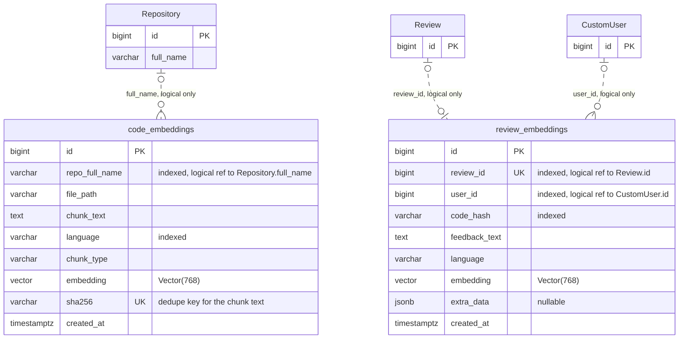
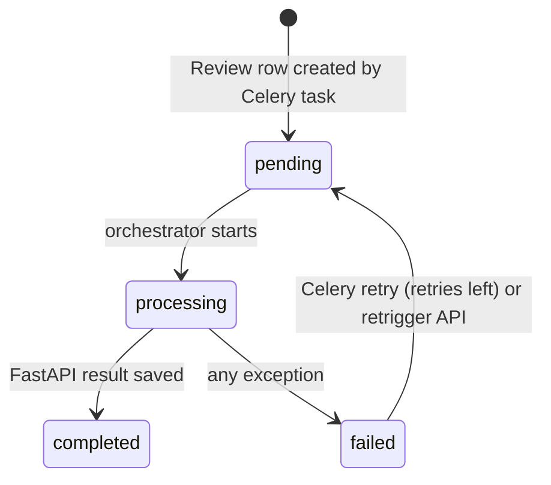

# System Architecture

## Table of Contents

1. [System Overview](#1-system-overview)
2. [Service Inventory](#2-service-inventory)
3. [Network Topology](#3-network-topology)
   - [Deployment diagram](#deployment-diagram-docker-composeyml)
   - [Redis usage by database](#redis-usage-by-database)
4. [End-to-End Flows](#4-end-to-end-flows)
   - [PR review triggered by a GitHub webhook](#pr-review-triggered-by-a-github-webhook)
   - [Repository scan flow](#repository-scan-flow)
5. [AI Review Pipeline](#5-ai-review-pipeline)
6. [Authentication and Authorization](#6-authentication-and-authorization)
7. [GitHub Integration](#7-github-integration)
8. [Data Model](#8-data-model)
   - [Django entities](#django-entities)
   - [FastAPI tables](#fastapi-tables-sqlalchemy-modelsembeddingspy)
9. [Reliability and Failure Handling](#9-reliability-and-failure-handling)
10. [Observability](#10-observability)
11. [Security Model](#11-security-model)
12. [Architectural Decisions](#12-architectural-decisions)

---

## 1. System Overview

DevMind is a monorepo with two backend processes and a React frontend:

- **Django** (`backend/django`) handles GitHub OAuth, users, repositories, webhook ingestion, review orchestration (in Celery tasks), the BYOK settings API and posting comments to GitHub. It uses the Django ORM, DRF, SimpleJWT and Celery. Channels consumers are defined in `realtime/` but are not currently served (see [WebSocket status](#websocket-status)).
- **FastAPI** (`backend/fastapi`) runs the AI work: diff parsing, embeddings and pgvector similarity search, prompt building, the LangGraph review agent and the multi-provider LLM client. It also runs a regex-based full-repository scan.
- **Frontend** (`frontend`) is a React + Vite single-page app. It talks only to Django (`/api/v1`) and never calls FastAPI.

Celery workers call FastAPI over HTTP with a shared secret (`X-Internal-Secret`), and FastAPI calls Django's internal BYOK endpoint the same way. In `docker-compose.yml` FastAPI's port 8001 is published to the host, and Nginx proxies `/fastapi-metrics` to it. FastAPI's `/health`, `/metrics` and `/docs` are unauthenticated. The routes that do work (`/review/*`, `/embeddings/*`, `/scan/*`) reject requests without the secret with 403.

---

## 2. Service Inventory

Services defined in `docker-compose.yml`:

| Service | Image / build | Host port | Role |
|---|---|---|---|
| `nginx` | `./nginx` | 80 | Reverse proxy: `/metrics` and `/` to Django, `/fastapi-metrics` to FastAPI |
| `django` | `backend/django` (dev target, `runserver`) | 8000 | REST API, OAuth, webhook receiver |
| `fastapi` | `backend/fastapi` (dev target, `uvicorn --reload`) | 8001 | AI service |
| `celery_worker` | same image as Django | - | Consumes queues `default`, `review`, `notifications` |
| `flower` | `mher/flower:2.0` | 5555 | Celery monitor UI, on the same `CELERY_BROKER_URL` as the worker |
| `postgres` | `pgvector/pgvector:pg16` | 5432 | Primary datastore; pgvector extension available |
| `redis` | `redis:7-alpine` | 6379 | Cache, channel layer, Celery broker/results, LLM rate limiter |
| `prometheus` | `prom/prometheus:latest` | 9090 | Scrapes Django and FastAPI via Nginx; 15-day retention |
| `grafana` | `grafana/grafana:latest` | 3000 | Provisioned Prometheus datasource and `devmind-overview` dashboard |

The frontend isn't a compose service. Run it with `pnpm dev` (port 5173). `frontend/Dockerfile` exists but compose doesn't use it.

Redis database allocation (db 0 for cache, channel layer and rate limiter; db 1 broker; db 2 results) is broken down in [Redis usage by database](#redis-usage-by-database). Flower reads `CELERY_BROKER_URL` too, so it watches the same broker database as the worker.

---

## 3. Network Topology

### Deployment diagram (docker-compose.yml)

The only deployment definition in the repo is `docker-compose.yml`, which builds the `dev` targets of both backend images. Ports in the labels are published to the host. All nine services share the default compose network and reach each other by service name.



Notes on the diagram:

- **Nginx routes** (`nginx/nginx.conf`): `/metrics` goes to `django:8000/metrics`, `/fastapi-metrics` to `fastapi:8001/metrics`, and `/health/` and `/` to Django. Nginx has no WebSocket upgrade block and doesn't route `/api` anywhere other than Django.
- **Published ports.** Django (8000) and FastAPI (8001) are published directly as well as sitting behind Nginx. Postgres (5432) and Redis (6379) are published too, which suits local development only.
- **Webhooks.** GitHub calls whatever URL `DEVMIND_PUBLIC_URL` points to. The `make ngrok` target tunnels to port 8000, so in local development webhooks reach Django directly. Nginx's `/` route would also forward them to Django.
- **Vite** runs on the host with `pnpm dev`. Its proxy (`frontend/vite.config.ts`) forwards `/api` and `/ws` to `localhost:8000`. The `/ws` proxy has nothing to connect to, because Django doesn't serve WebSockets (see [WebSocket status](#websocket-status)).
- **Prometheus** scrapes both apps through `nginx:80` (`prometheus/prometheus.yml`), and Grafana reads from Prometheus with a provisioned datasource.

### Redis usage by database

All values come from the defaults in `.env.example` and `devmind/settings/base.py`; FastAPI's `redis_url` defaults to db 0 as well.

| DB | Variable | Used by | What for (verified in code) |
|---|---|---|---|
| 0 | `REDIS_URL` | Django | Django cache (`django_redis`): OAuth `state` tokens (10 min, `apps/accounts/oauth.py`), organization invite tokens (72 h, `apps/organizations/views.py`) and DRF throttle counters (base settings only; development and test settings turn throttling off). `/health/` pings this connection. |
| 0 | `REDIS_URL` | Django, Celery worker | Channels layer (`channels_redis`). The orchestrator calls `group_send` on status changes; nothing serves the consumers yet. |
| 0 | `redis_url` | FastAPI | LLM rate-limit counters `ratelimit:{provider}:{minute}` (`services/rate_limiter.py`) |
| 1 | `CELERY_BROKER_URL` | Django, Celery worker, Flower | Task broker |
| 2 | `CELERY_RESULT_BACKEND` | Celery worker | Task results |

### Trust boundaries in this topology

- Browser traffic reaches Django only (through Vite in development). The frontend never calls FastAPI.
- Celery to FastAPI and FastAPI to Django use the shared `X-Internal-Secret` header. Calls on the compose network are plain HTTP.
- FastAPI's CORS middleware allows only `http://localhost:8000`. That stops browsers on other origins from calling it, but it isn't access control. Access control comes from the internal secret.
- FastAPI's `/health`, `/metrics` and `/docs` need no secret (`/docs` is disabled when `SENTRY_ENVIRONMENT=production`), and port 8001 is published, so anyone who can reach the host can read them.

---

## 4. End-to-End Flows

### PR review triggered by a GitHub webhook



On each status change, the orchestrator also calls `channel_layer.group_send` (group `review_<id>`) and, when Supabase is configured, pushes the status there. Both are best-effort.

### Idempotency

`repositories.trigger_review` looks for an existing `Review` with the same repository, PR number and head SHA. If one exists, it doesn't create another. It re-dispatches the review task only when the existing review is `pending` or `failed`.

### Trigger: manual retrigger

`POST /api/v1/reviews/<id>/retrigger/` is available to the repository owner and only when the review is `pending` or `failed`. A review in `processing` returns 409, and a `completed` review returns 400. The view resets the review to `pending`, clears the risk score, summary and completion time, and queues `trigger_review_task`.

There is no API route for creating a review by hand. `GET /api/v1/reviews/` is read-only. (`ReviewCreateView` exists in `apps/reviews/views.py` and returns 405, but it isn't routed.)

### Repository scan flow

A scan is a regex-based check of a whole repository (hard-coded secret patterns, `eval`/`exec`, `os.system`, unsafe deserialization, long lines and functions, TODO markers). It is separate from PR reviews and makes no LLM calls.



What the code shows about this flow:

- **Scans never complete in Django.** `full_repo_scan_task` (`apps/reviews/tasks.py`) stores FastAPI's `scan_id` and returns. No task or view reads `/scan/status/{id}` or `/scan/report/{id}`, so `progress`, issue counts and `completed_at` are never filled in, and the row stays `scanning`.
- **The 24-hour limit doesn't apply yet.** `RepoScanTriggerView` only blocks a new scan when the latest one is `completed`, which never happens today.
- **Results are lost on restart.** FastAPI keeps scan progress and issues in a module-level dict. Restarting the process, including a `--reload`, drops them.
- **Failure handling.** If FastAPI doesn't answer 202, the task marks the scan `failed` and retries (`max_retries=3`, 60 s apart). Each retry sets the status back to `scanning` first.
- **No GitHub token.** Django doesn't send `github_token`, so FastAPI's `GitHubClient` makes unauthenticated requests. Private repository contents need a token.

---

## 5. AI Review Pipeline

### LangGraph agent: 4-node StateGraph

Defined in `backend/fastapi/agents/review_agent.py`:



**One pass.** The graph has no loop. A review makes one LLM call per analyzer, so 3 calls in total whether or not anything is found, unless a response can't be parsed (below).

**Retry on unparseable output only.** `REVIEW_SYSTEM_PROMPT` and each analyzer's instruction ask for only a JSON list, with severities `critical`, `error`, `warning` or `info`, and `[]` when there are no issues. If `_parse_llm_comment_list` can't find a JSON list in an analyzer's response (or the response is empty), that analyzer repeats its call once (`MAX_PARSE_RETRIES = 1`). The retry sends the original messages plus the model's reply and a corrective user turn (`CORRECTIVE_PROMPT`: "Your previous reply was not a JSON list. Reply with only the JSON list, or [] if there are no issues."). The other analyzers are not re-run. A parsed empty list is a valid result, and so are `{}` and a known wrapper key set to null, such as `{"issues": null}`.

**Parallel branches.** The three analyzer nodes write to `security_comments`, `quality_comments` and `test_comments`, which use the `_extend_list` reducer in `agents/states.py`. All three also write `analyzer_runs` in the same step, each under its own key (`security`, `quality`, `tests`); the `_merge_dict` reducer combines them. `synthesize` then deduplicates the findings.

**`analyzer_runs`.** Each entry holds `model`, `latency_ms`, `prompt_tokens`, `completion_tokens`, `attempts` and `parsed`. Latency and token counts are summed over attempts; token counts stay `null` if the provider never reports them. `parsed` is false when every attempt was unparseable, which tells a failed analyzer apart from one that found nothing. `POST /review/analyze` returns it as `analyzer_runs`.

**`model_used`.** `synthesize` takes the model of the first analyzer in the order security, quality, tests that has one, so the value doesn't depend on which branch finished last.

**LLM response parsing** (`_parse_llm_comment_list`):

1. Strip markdown code fences, then `json.loads`. This handles a bare array or an object that wraps an array.
2. If that fails, extract the outermost `[...]` and parse that.

Each item is validated against `_LLMCommentSchema` (Pydantic). Severities `high`, `medium` and `low` map to `error`, `warning` and `info`; any other unknown severity becomes `warning`.

**Risk score** (`calculate_risk_score` in `routers/review.py`): the base for the highest severity (critical 70, error 45, warning 20, info 5), plus 3 for each other finding above info, at most +15, so the maximum is 85. Unknown severities count as info. Many info or warning notes can't outscore one critical finding.

### Retrieval (RAG) steps in `POST /review/analyze`

```
parse_diff(diff)                       -> DiffChunk[] (file, language, added/removed/context lines)
for up to 20 chunks:
    store_code_embedding(...)          -> Google text-embedding-004, task_type RETRIEVAL_DOCUMENT,
                                          768 dims, deduplicated by sha256 of the chunk text
search_similar(diff[:2000], repo, top_k=5, threshold=0.6)
                                       -> task_type RETRIEVAL_QUERY, ordered by pgvector cosine distance
build_review_prompt(...)               -> 8192-token budget (tiktoken cl100k_base); diff first,
                                          then similar patterns, quality patterns, past reviews, conventions
run_review_agent(...)
```

The handler runs these steps inside a `try`. A failure in embedding or search is logged as `review.rag_context_partial`, and the review continues without similar-code context. After the response is built, a background task also stores an embedding of the first 1000 characters of the diff.

Embeddings are cached in process by an LRU cache (`_BoundedCache`, max 1000 entries) keyed by `sha256(f"{task_type}:{text}")`.

**Setup gap:** no migration or startup hook creates the `vector` extension or the `code_embeddings` / `review_embeddings` tables (`models/embeddings.py` defines them; nothing calls `create_all`). On a fresh database the retrieval steps fail and get logged, and reviews run without retrieved context.

### LLM provider failover



- A server provider is included only if its key (`GOOGLE_AI_API_KEY`, `GROQ_API_KEY`, `GITHUB_TOKEN`) is set. There is no server-side OpenAI provider; OpenAI is available only as a user BYOK provider.
- BYOK providers are mapped to an OpenAI-compatible base URL: `openai`, `groq`, `mistral`, `google_vertex`, or `custom` with an explicit URL. `anthropic` isn't mapped, so Anthropic configs are skipped.
- `LLM_FAILOVER_ENABLED=False` uses only the first provider in the chain.

**Rate limiting** (`services/rate_limiter.py`): a fixed one-minute window per provider, using the Redis key `ratelimit:{provider}:{minute}` with atomic `INCR` and a 60-second expiry. Default limits are Google 15 RPM, Groq 30 and GitHub Models 150; BYOK providers get 30. When a window is full, the call **sleeps until the next minute** rather than failing over. If Redis is unavailable, the limiter lets the request through.

---

## 6. Authentication and Authorization

### GitHub OAuth flow



The state token comes from `secrets.token_urlsafe(32)` (`apps/accounts/oauth.py`). The redirect target is the callback URL configured on the GitHub OAuth App; Django doesn't send a `redirect_uri`.

### JWT configuration (`SIMPLE_JWT` in `devmind/settings/base.py`)

| Parameter | Value |
|---|---|
| Algorithm | `JWT_ALGORITHM`, default HS256 |
| Signing key | `JWT_SECRET_KEY` |
| Access lifetime | `JWT_ACCESS_TOKEN_EXPIRE_MINUTES`, default 60 |
| Refresh lifetime | `JWT_REFRESH_TOKEN_EXPIRE_DAYS`, default 30 |
| Rotation / blacklist | `ROTATE_REFRESH_TOKENS` and `BLACKLIST_AFTER_ROTATION` both on |

The frontend stores both tokens in `localStorage` and refreshes on 401 (`frontend/src/api/client.ts`).

### WebSocket status

`devmind/asgi.py` builds a Channels `ProtocolTypeRouter` with `JwtQueryAuthMiddleware`, which reads `?token=` from the URL. `realtime/routing.py` maps `ws/reviews/<id>/` and `ws/notifications/`. The consumers are covered by `realtime/tests/test_consumers.py`.

None of this is served today:

- `ASGI_APPLICATION` isn't set and `daphne` isn't in `INSTALLED_APPS`, so `runserver` serves HTTP only (a WebSocket upgrade to `/ws/reviews/1/` returns 404).
- The production image runs `gunicorn devmind.wsgi:application`.
- `nginx/nginx.conf` has no WebSocket upgrade block.

Separately, `ReviewStatusConsumer` accepts any authenticated user for any review ID without checking ownership. That needs fixing before the endpoint is enabled.

### Service-to-service authentication

- Header: `X-Internal-Secret: <FASTAPI_INTERNAL_SECRET>`
- FastAPI checks it with `hmac.compare_digest` (`core/security.py`) on the `/review`, `/embeddings` and `/scan` routers. An empty secret on either side counts as a failure (403).
- Django's `InternalLLMConfigListView` applies the same check to `GET /api/v1/auth/internal/llm-configs/`. That endpoint returns decrypted BYOK keys to FastAPI.

### DRF defaults

- Authentication: JWT only. Default permission: `IsAuthenticated`.
- Throttling in `base.py`: anonymous 100/hour, authenticated `API_GLOBAL_RATE_LIMIT`/hour (default 1000). The development and test settings turn throttling off.
- Pagination: `PageNumberPagination`, page size 20.

---

## 7. GitHub Integration

### Webhook handling

Endpoint: `POST /api/v1/webhooks/github/`. It has no JWT authentication (`authentication_classes = []`) and requires an HMAC signature (`apps/repositories/webhooks.py`).

```python
configured_secret = settings.GITHUB_WEBHOOK_SECRET or ""
if not configured_secret:
    raise WebhookVerificationError(...)          # -> 403
expected = "sha256=" + hmac.new(secret, request.body, hashlib.sha256).hexdigest()
if not hmac.compare_digest(expected, signature_header):
    raise WebhookVerificationError(...)          # -> 403
```

| Event | Action | Behavior |
|---|---|---|
| `pull_request` | `opened`, `synchronize`, `reopened` | Repo must be known, active and `review_enabled`; enqueue `repositories.trigger_review` |
| `pull_request` | anything else | Ignored |
| `ping` | - | Logged |
| any other event | - | Ignored |

### Webhook lifecycle



`install_webhook_task` skips repositories that already have a `webhook_id`. It retries GitHub rate-limit errors after one hour (`RATE_LIMIT_RETRY_COUNTDOWN = 3600`) and other failures up to 5 times. `remove_webhook_task` exists, but only the Django admin calls it; there is no API route for disconnecting a repository.

### Comment posting

`GitHubPoster` (`apps/reviews/services/github_poster.py`):

- Comments with `line_number > 0` are posted inline (`line`, `side: RIGHT`), grouped by file and sent in batches of 50 per review.
- Comments without a usable line number are folded into the review body.
- If GitHub returns 422 for an inline batch, the poster retries the batch as a body-only review so the findings still appear.
- Every review is posted with `event: COMMENT`, so DevMind never approves a PR or requests changes.

---

## 8. Data Model

### Django entities

Fields are taken from the models in `apps/accounts`, `apps/repositories`, `apps/reviews` and `apps/organizations`. The diagram shows selected fields: timestamps (`created_at`, `updated_at`), auth bookkeeping (`password`, `last_login`, `is_superuser`) and descriptive text such as `Repository.description` are left out to keep it readable. `encrypted` marks an `EncryptedCharField`: a `varchar` column holding a Fernet token.



Constraints the diagram can't show:

- `UserLLMConfig`: unique on `(user, provider, model_name)`, default ordering `priority`, then newest first.
- `TeamMembership`: unique on `(organization, user)`. `OrgRepository`: unique on `(organization, repository)`.
- `Review` has no unique constraint on `(repository, pr_number, head_sha)`. Duplicate webhooks are filtered in `repositories.trigger_review` instead (see [Idempotency](#idempotency)).
- `Repository.github_id` is unique, so a GitHub repository has exactly one DevMind owner. `initial_sync` upserts by `github_id` and sets `owner` to the syncing user, so a second user syncing the same repository takes it over.
- Deleting a user cascades to their token, LLM configs, repositories (and so their reviews and scans) and memberships. A user who owns an organization can't be deleted (`PROTECT`).

**Organizations and invites.** Organizations, memberships and org-repository links are stored in Postgres, but invites aren't. `POST organizations/<id>/invite/` stores `org_invite:<token>` -> `"<org_id>:<email>"` in the Django cache (Redis db 0) for 72 hours and queues an email task. Accepting the invite checks that the signed-in user's email matches, creates a `member` membership and deletes the key. Some limits of the current code:

- `OrgRepository` rows can only be created in the Django admin. No API view creates or lists them.
- Organization membership doesn't grant access to anything. Repository, review and scan views all filter by `Repository.owner`.
- `sync_org_members_task` (GitHub org member sync) is defined but nothing calls it.

### Indexes

| Table | Index |
|---|---|
| `reviews_review` | `(repository, pr_number)`, `(completed_at)`, `status` |
| `reviews_reviewcomment` | `(review, severity)`, `(review, file_path, line_number)` |
| `reviews_reposcan` | `status` |
| `repositories_repository` | `(owner, is_active)`, `(github_id)`, `full_name`, `is_active` |
| `organizations_organization` | `slug` (unique), `github_org_id` (unique) |

### FastAPI tables (SQLAlchemy, `models/embeddings.py`)

FastAPI owns two pgvector tables in the same Postgres database. They are defined only in SQLAlchemy, have no Django model and no migration, and aren't joined to Django tables by any foreign key.



The dotted lines are **logical references, not foreign keys**. Nothing enforces that the Django row exists, and deleting a Django repository or review leaves its embeddings in place.

- `code_embeddings.repo_full_name` is the `repo_full_name` the Celery worker sends to `POST /review/analyze`. It holds a name, not an ID, so when `initial_sync` picks up a renamed repository, its older chunks stay under the old name. Each review writes up to 20 diff chunks here, plus one row for the first 1000 characters of the diff (`file_path` `PR#<number>`, `chunk_type` `pr`).
- `review_embeddings.review_id` and `user_id` are meant to hold Django `Review` and `CustomUser` IDs, but nothing in the application writes this table today. `VectorStore.store_review_embedding` is only called from tests, and the `/review/analyze` request carries `user_id` but no review ID. As a result, the "past reviews" section of the prompt is always empty.

There are B-tree indexes on `repo_full_name`, `language`, `review_id`, `user_id` and `code_hash`. There is no vector (HNSW or IVFFlat) index, so similarity search scans the table sequentially. As noted in section 5, nothing in the repo creates these tables yet.

### Enum values

- `Review.status`: `pending`, `processing`, `completed`, `failed`
- `ReviewComment.severity`: `info`, `warning`, `error`, `critical`
- `ReviewComment.category`: `security`, `quality`, `tests`, `style`, `performance`
- `UserLLMConfig.provider`: `openai`, `anthropic`, `google_vertex`, `mistral`, `custom`
- `RepoScan.status`: `queued`, `scanning`, `completed`, `failed`
- `TeamMembership.role`: `owner`, `admin`, `member`

---

## 9. Reliability and Failure Handling

### Retry strategy

| Layer | Mechanism |
|---|---|
| Orchestrator to FastAPI | tenacity: 3 attempts, exponential backoff 5-60s, on timeout or 503 only. 403, 429 and other errors fail immediately. |
| `apps.reviews.tasks.trigger_review_task` | Celery `max_retries=3`, 60s delay. Resets a `failed` review to `pending` before each retry; on the final attempt it stays `failed`. |
| `post_github_comments_task` | Celery `max_retries=3`, independent of the review task |
| `repositories.trigger_review` | Celery `max_retries=3`, `acks_late=True` |
| `repositories.install_webhook` | Celery `max_retries=5`; 1-hour countdown on GitHub rate limits |
| GitHub API calls in `GitHubService` | tenacity retries on transient server errors |

### Review status machine



### Graceful degradation

| Failure | Behavior |
|---|---|
| Redis unavailable (FastAPI) | Rate limiter logs and lets the request through |
| Channels push fails | Caught and logged |
| Supabase unavailable | Caught and logged; review continues |
| An LLM provider fails | Next provider in the chain; all failed means FastAPI returns 429 and the review fails |
| Embedding/search fails | Logged; review runs without retrieved context |

### Celery queues

Routes from `CELERY_TASK_ROUTES` in `base.py`:

| Queue | Tasks |
|---|---|
| `review` | `repositories.trigger_review` |
| `default` | `apps.reviews.tasks.trigger_review_task`, `post_github_comments_task`, `full_repo_scan_task`, `cleanup_old_reviews`, `repositories.initial_sync`, `install_webhook`, `remove_webhook`, organization tasks; also the default for unrouted tasks |
| `notifications` | Consumed by the worker; no task is currently routed to it |

There is no Celery beat service, so `cleanup_old_reviews` runs only if someone calls it.

---

## 10. Observability

### Metrics endpoints

| Endpoint | Source |
|---|---|
| `/metrics` (Django, also via Nginx) | `django_prometheus` middleware and URLs |
| `/metrics` on FastAPI, `/fastapi-metrics` via Nginx | `prometheus_fastapi_instrumentator` |

`prometheus/prometheus.yml` scrapes both through `nginx:80` every 15 seconds.

Recorded metrics:

- **Django:** only the HTTP metrics from django-prometheus (for example `django_http_requests_total_by_view_transport_method_total` and `django_http_requests_latency_seconds_by_view_method`). Django defines no custom metrics.
- **FastAPI HTTP:** `http_requests_total` and `http_request_duration_seconds` from the instrumentator.
- **FastAPI custom** (`core/metrics.py`, recorded in `routers/review.py`): `agent_iterations_total` (one per `POST /review/analyze`), `rag_pipeline_duration_ms` (successful reviews only) and `review_errors_total` by `error_type`.

**Grafana:** the provisioned "DevMind Overview" dashboard (`grafana/provisioning/dashboards/devmind-overview.json`) charts Django and FastAPI request rate and p50/p95/p99 latency, plus the three FastAPI review metrics. There are no Celery or LLM-token metrics.

### Logging

Django logs to the console with a `verbose` text formatter. Some modules use `structlog`. FastAPI configures logging in `core/logging.py` at startup.

### Health checks

| Endpoint | Checks | Response |
|---|---|---|
| Django `GET /health/` | DB connection, Redis `PING` | Always HTTP 200; body reports `db` / `redis` as `ok` or `error` |
| FastAPI `GET /health` | `SELECT 1`, pgvector extension present, `GET /models` on each configured server provider | 503 if DB or pgvector check fails, else 200. Exception details are logged server-side and not returned. |

### Error tracking

Each service calls `sentry_sdk.init` when its DSN (`SENTRY_DSN_DJANGO` / `SENTRY_DSN_FASTAPI`) is non-empty. `traces_sample_rate` defaults to 0.1.

---

## 11. Security Model

To report a vulnerability, follow [SECURITY.md](../SECURITY.md).

### Trust boundaries

```
Browser -> Django                 JWT (Bearer), DRF throttling (base settings), CORS allow-list
GitHub  -> Django webhook         HMAC-SHA256; rejected when no secret is configured
Celery  -> FastAPI work routes    X-Internal-Secret, constant-time compare
FastAPI -> Django BYOK endpoint   X-Internal-Secret, constant-time compare
User-supplied BYOK base_url      https + public-address check in Django on save and before
                                  the key test; FastAPI calls the stored URL without
                                  re-validating it (rows saved before the check are unguarded)
```

### Encryption at rest

| Data | Mechanism |
|---|---|
| `GithubToken.access_token` | `EncryptedCharField`: Fernet with a key derived from `SECRET_KEY` (HKDF-SHA256, fixed salt) |
| `UserLLMConfig.api_key` | Same field type and key |

There's no separate encryption-key variable. Changing `DJANGO_SECRET_KEY` makes existing tokens and API keys impossible to decrypt.

### Where secrets leave the server

- `GET /api/v1/auth/github/token/` returns the authenticated user's decrypted GitHub token to the browser.
- `GET /api/v1/auth/internal/llm-configs/` returns decrypted BYOK keys to FastAPI (secret-protected).

### Input validation

- The webhook signature is verified before the payload is dispatched.
- BYOK `base_url` is validated in the serializer and again right before the key-test request (`validate_public_https_url`). It must be https, and every resolved address must be public. DNS rebinding between check and use isn't covered, as the code comments say.
- `ReviewOrchestrator._save_results` maps unknown categories to `quality` and unknown severities to `info` before inserting.
- LLM output is validated with Pydantic before it reaches the response model.

### BYOK key validation

When a user creates a config, `_validate_provider_key` sends `GET <base>/models` to the provider, and keys that fail are rejected. The test settings skip this (`SKIP_LLM_KEY_VALIDATION=True`).

---

## 12. Architectural Decisions

Each decision lists what the code does, why, and the trade-offs. Some also note what would change at larger scale; those notes are considerations, not plans or measured limits.

- [Two backends (Django + FastAPI)](#two-backends-django--fastapi)
- [Celery for review jobs](#celery-for-review-jobs)
- [LangGraph for the review agent](#langgraph-for-the-review-agent)
- [pgvector instead of a dedicated vector database](#pgvector-instead-of-a-dedicated-vector-database)
- [Redis-backed LLM rate limiter](#redis-backed-llm-rate-limiter)
- [Storing the diff in `ReviewRun.diff_text`](#storing-the-diff-in-reviewrundiff_text)
- [Removing Kafka instead of keeping it as unused infrastructure](#removing-kafka-instead-of-keeping-it-as-unused-infrastructure)
- [BYOK-first LLM failover with server providers as fallback](#byok-first-llm-failover-with-server-providers-as-fallback)
- [Token encryption with Fernet and a key derived from SECRET_KEY](#token-encryption-with-fernet-and-a-key-derived-from-secret_key)
- [JWTs in localStorage](#jwts-in-localstorage)
- [GitHub OAuth App and per-repository webhooks instead of a GitHub App](#github-oauth-app-and-per-repository-webhooks-instead-of-a-github-app)
- [Fetch on demand instead of WebSockets for review status](#fetch-on-demand-instead-of-websockets-for-review-status)
- [One Redis instance in several roles](#one-redis-instance-in-several-roles)
- [Shared-secret service-to-service authentication](#shared-secret-service-to-service-authentication)

### Two backends (Django + FastAPI)

**What:** Django owns the user-facing API and data. FastAPI owns the LLM and vector work.

**Why:** Django provides the ORM, admin, DRF and Celery integration needed for CRUD, OAuth and background jobs. The AI path is I/O-bound, with concurrent LLM calls and async database queries, which suits an async framework with Pydantic models.

**Tradeoffs:** two dependency sets and images, a shared secret to keep in sync, and an HTTP hop between them.

### Celery for review jobs

**What:** Webhook handling only queues work; reviews run in Celery tasks.

**Why:** A review involves several LLM calls and can take much longer than a webhook delivery should wait. Queuing lets the webhook return immediately and keeps slow reviews from tying up web workers.

**Tradeoffs:** another moving part (broker and workers), and results reach the UI only when it fetches them.

### LangGraph for the review agent

**What:** The review is a `StateGraph` with typed state and parallel analyzer branches that merge in one `synthesize` node.

**Why:** The graph makes the pipeline explicit, so each node can be tested in isolation, and adding an analyzer means adding a node and two edges.

**Tradeoffs:** Parallel branches need explicit reducers. Without `_extend_list`, results from all but one analyzer are lost.

### pgvector instead of a dedicated vector database

**What:** Embeddings live in the same PostgreSQL instance as everything else.

**Why:** It avoids a second datastore to run, back up and secure. The interface is contained in `services/vector_store.py`.

**Tradeoffs:** shared connection pool; no vector index is defined yet, so search cost grows linearly with stored chunks.

### Redis-backed LLM rate limiter

**What:** Per-provider RPM counters live in Redis rather than in process memory.

**Why:** Each uvicorn worker has its own memory, so in-process counters would let every worker use the full provider limit.

**Tradeoffs:** If Redis fails, rate limiting turns off. Over-limit calls sleep until the next minute instead of trying another provider.

### Storing the diff in `ReviewRun.diff_text`

**What:** The diff sent to FastAPI is saved with the review run.

**Why:** The review page can render the diff without calling GitHub again with the user's token.

**Tradeoffs:** unbounded `TextField`, no compression or size cap.

### Removing Kafka instead of keeping it as unused infrastructure

**What:** Commit `cd590b5` removed the Kafka producer (`devmind/kafka.py`), its call sites in the webhook handler and the orchestrator, the `confluent-kafka` dependency, the `KAFKA_BOOTSTRAP_SERVERS` setting and the `kafka` compose service. Commit `ab47a35` removed the `celery_beat` service for the same reason: no periodic tasks were defined.

**Why:** The producer published events such as `devmind.pr.opened` and `devmind.review.completed` fire-and-forget, but nothing consumed them. No consumer exists anywhere in the git history. The broker added a container, a dependency, settings and tests while doing no work that anything depended on.

**Tradeoffs:** There's no event log for a future consumer such as analytics or an audit trail. Adding one means re-adding the producer calls as well as the broker. Celery tasks are now the only asynchronous path.

**What would change at larger scale:** If several independent consumers need the same events, a durable event stream could be worth reintroducing. With a single consumer per event, a Celery task covers the same need.

### BYOK-first LLM failover with server providers as fallback

**What:** For each LLM call, `LLMClient.generate` (`backend/fastapi/services/llm_client.py`) fetches the user's active BYOK configs from Django's internal endpoint, ordered by `priority`, and puts them ahead of the server chain: Google `gemini-2.0-flash`, Groq `llama-3.3-70b-versatile`, GitHub Models `gpt-4o-mini`. Each server provider is included only if its key is set. A 429, a 5xx, any other non-200 status or a timeout moves the call to the next entry. All entries are called through the OpenAI-compatible `/chat/completions` API.

**Why:** A user's own key is used whenever it works, and a review still runs when it doesn't, or when the user has none. One request format covers every provider, so adding a provider means adding a base URL.

**Tradeoffs:**
- Failover is silent. An invalid or revoked user key (401) and a failed BYOK fetch (the client logs it and returns an empty list) both fall through to the server's keys, so the server pays for that review.
- The BYOK configs are fetched from Django on every `generate` call. Each pass makes three calls (one per analyzer) and the agent can make up to three passes, so one review can make up to nine internal requests that return decrypted keys.
- Providers without an OpenAI-compatible endpoint, such as Anthropic, are skipped.
- When a provider's per-minute window is full, the rate limiter waits for the next minute instead of moving to the next provider.

**What would change at larger scale:** Caching the BYOK configs per review, and surfacing to the user which provider actually served a review (the response already includes `model_used` and `provider`), would reduce internal traffic and make silent fallbacks visible.

### Token encryption with Fernet and a key derived from SECRET_KEY

**What:** `EncryptedCharField` (`apps/accounts/encryption.py`) encrypts GitHub OAuth tokens and BYOK API keys with Fernet. The Fernet key is derived from Django's `SECRET_KEY` with HKDF-SHA256, using the salt `b"devmind-github-token-encryption-v1"` and the info string `b"fernet-encryption-key"`, both hard-coded.

**Why:** Database rows and backups don't hold plaintext secrets, and there's no extra key to provision: any deployment with a `SECRET_KEY` can encrypt.

**Tradeoffs:**
- **Rotation.** There's one key and no key list (`MultiFernet`) or re-encryption command. Changing `DJANGO_SECRET_KEY` makes every stored token and API key undecryptable, and `from_db_value` doesn't catch the resulting `InvalidToken`, so reading those rows raises.
- **Coupled secrets.** `SECRET_KEY` both signs Django data and protects these credentials, so anyone who has it and a database copy can decrypt everything.
- **Hard-coded salt.** The salt is in source, and the code comment says it should move to an environment variable in production. HKDF doesn't need a secret salt, so the real protection is the secrecy of `SECRET_KEY`. Changing the salt has the same effect as changing the key.

**What would change at larger scale:** A dedicated encryption key (or a key-management service) separate from `SECRET_KEY`, with `MultiFernet` to decrypt with old keys while re-encrypting with a new one, would allow rotation without data loss.

### JWTs in localStorage

**What:** SimpleJWT issues an access token (60 minutes by default) and a refresh token (30 days by default, rotated and blacklisted after rotation). The frontend stores both in `localStorage` and sends `Authorization: Bearer` (`frontend/src/api/client.ts`). The unused WebSocket client would also put the access token in the URL query string.

**Why:** It's the simplest setup for a SPA: the axios client adds the header in one interceptor and refreshes on 401, and the API needs no cookie or CSRF configuration. Because the browser never attaches a bearer token on its own, the JWT-authenticated API isn't exposed to CSRF.

**Tradeoffs:** Any script that runs on the frontend's origin can read both tokens. A stolen refresh token stays usable for up to 30 days unless it's rotated or blacklisted first, and with an access token an attacker can also call `GET /api/v1/auth/github/token/`, which returns the user's decrypted GitHub token (scope `repo,user`). Neither `nginx.conf` nor the Django settings set a Content-Security-Policy.

**What would change at larger scale:** Moving the refresh token to an `HttpOnly`, `Secure`, `SameSite` cookie (with CSRF protection on the refresh endpoint), adding a CSP, and removing the GitHub-token endpoint would shrink what a single XSS bug exposes.

### GitHub OAuth App and per-repository webhooks instead of a GitHub App

**What:** Users sign in through a GitHub OAuth App with scope `repo,user`. `POST /repositories/connect/` queues `initial_sync`, which lists every repository the token can see (`/user/repos?type=all`) and queues `install_webhook` for each one without a `webhook_id`. That task calls `POST /repos/{owner}/{repo}/hooks` with the user's token, subscribing to `pull_request` and `push` and using the single `GITHUB_WEBHOOK_SECRET`. Diffs are fetched and review comments posted with the repository owner's token.

**Why:** One OAuth flow covers both sign-in and repository access. There's no app installation step and no app private key or installation-token exchange to manage.

**Tradeoffs:**
- The `repo` scope gives read and write access to all of the user's repositories, not only the ones DevMind reviews.
- Webhooks go onto every synced repository, not just ones the user picked. Creating a webhook needs admin rights on the repository; GitHub's 422 response is raised as `WebhookInstallError`.
- Review comments appear as the repository owner, not as a bot account.
- Every repository shares one webhook secret. `push` events are delivered but ignored.
- Removing webhooks is only possible from the Django admin.

**What would change at larger scale:** A GitHub App would allow per-repository installation, fine-grained permissions, short-lived installation tokens, one app-level webhook and a bot identity for comments. Adopting one would mean replacing the token storage, sync and webhook-install code.

### Fetch on demand instead of WebSockets for review status

**What:** The frontend learns review and scan status by HTTP requests: the dashboard and review pages fetch `GET /reviews/` or `GET /reviews/<id>/` when they load, and the scan page fetches `GET /reviews/scans/<id>/` on load and when the user clicks Refresh. Nothing polls on a timer. `ReviewStatus.tsx` tries to open `ws/reviews/<id>/` and stays static when that fails, which it always does today.

**Why:** This is the current state rather than a finished design. The WebSocket pieces exist (Channels consumers in `realtime/`, a `ProtocolTypeRouter` in `devmind/asgi.py`, the Vite `/ws` proxy and orchestrator `group_send` calls), but `ASGI_APPLICATION` isn't set, the production image runs `gunicorn devmind.wsgi:application` and Nginx has no upgrade block. The orchestrator can also push status to Supabase, but the frontend doesn't read from Supabase.

**Tradeoffs:** Users reload to see a review finish. In exchange, the server only has to handle short HTTP requests under WSGI, with no long-lived connections.

**What would change at larger scale:** Serving the existing consumers needs an ASGI server, `ASGI_APPLICATION`, an Nginx upgrade route and an ownership check in `ReviewStatusConsumer`, which today accepts any authenticated user for any review ID. Polling `GET /reviews/<id>/` on an interval is the simpler alternative, at the cost of extra read traffic.

### One Redis instance in several roles

**What:** A single `redis:7-alpine` service is the Celery broker (db 1) and result backend (db 2), the Django cache for OAuth state, invite tokens and DRF throttle counters, the Channels layer, and the FastAPI rate-limit store (all db 0). See [Redis usage by database](#redis-usage-by-database).

**Why:** It's one service to run, and every role needs short-lived keys or queues, which Redis handles well. Separate database numbers keep broker and result keys apart from cache keys.

**Tradeoffs:** Redis is a single point of failure, and the failure behavior varies:
- The webhook view doesn't catch errors from `.delay()`, so webhook deliveries fail with a server error and reviews aren't queued.
- GitHub sign-in fails, because the OAuth state can't be stored or checked.
- Pending invites live only in Redis, so losing the data loses the invites.
- The FastAPI rate limiter fails open and lets requests through. Channels pushes are caught and logged.
- `/health/` reports `redis: error` but still answers 200.

`docker-compose.yml` gives Redis no named volume, persistence options or password, and database numbers aren't access control: any client that can reach the port can select any database.

**What would change at larger scale:** Splitting the broker from the cache, adding persistence or a managed Redis with failover, and alerting on the `/health/` Redis field are the obvious first steps.

### Shared-secret service-to-service authentication

**What:** Celery to FastAPI (`/review`, `/embeddings`, `/scan`) and FastAPI to Django (`/api/v1/auth/internal/llm-configs/`) both authenticate with one value, `FASTAPI_INTERNAL_SECRET`, sent as `X-Internal-Secret` and compared with `hmac.compare_digest`. An empty secret on either side fails closed with 403.

**Why:** Both services run on one compose network and are deployed together, so one environment variable is enough. There are no certificates to issue and no token service to run.

**Tradeoffs:**
- The secret is static and identical in both directions, so a leak lets the holder call FastAPI and read every user's decrypted BYOK keys from Django.
- Requests aren't signed and have no expiry, so a captured request can be replayed.
- The calls are plain HTTP, so anything that can observe compose-network traffic can read the secret.
- Rotation means updating both services at the same time.

**What would change at larger scale:** Separate secrets per direction, short-lived signed tokens (for example JWTs with an audience and expiry), or mTLS between services would limit what one leaked credential exposes. Network isolation that keeps port 8001 unpublished would also help.
