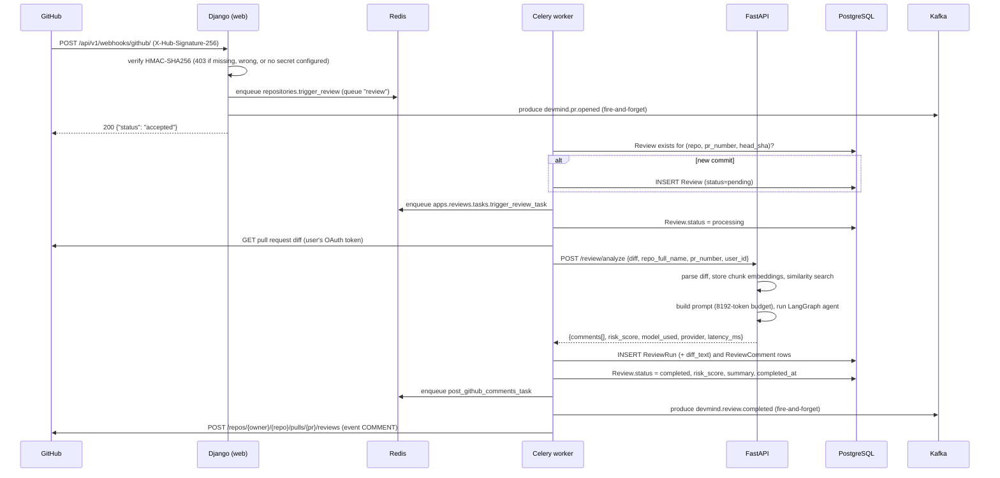
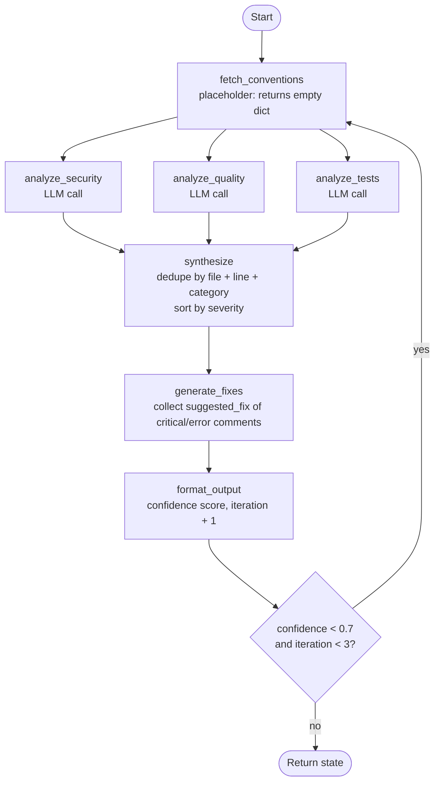
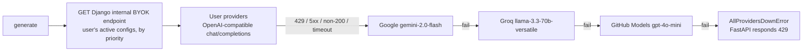
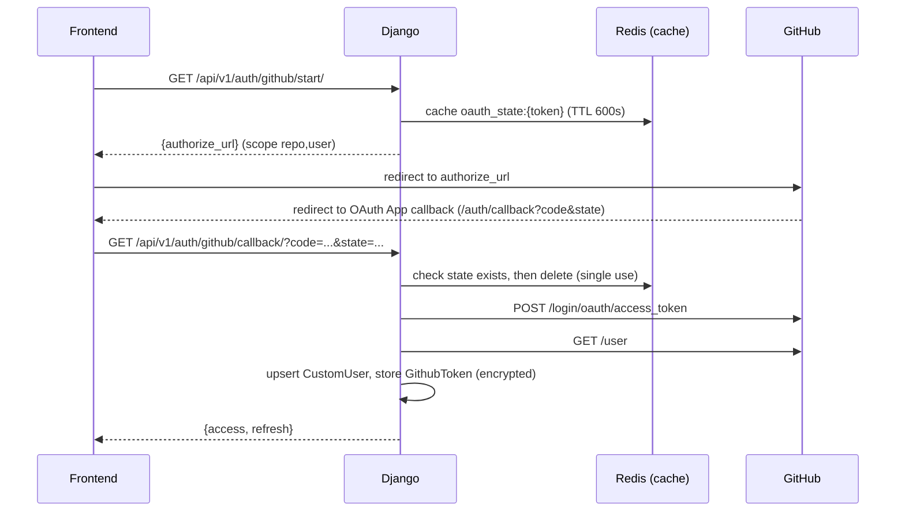
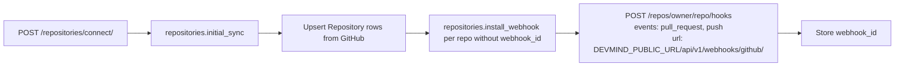
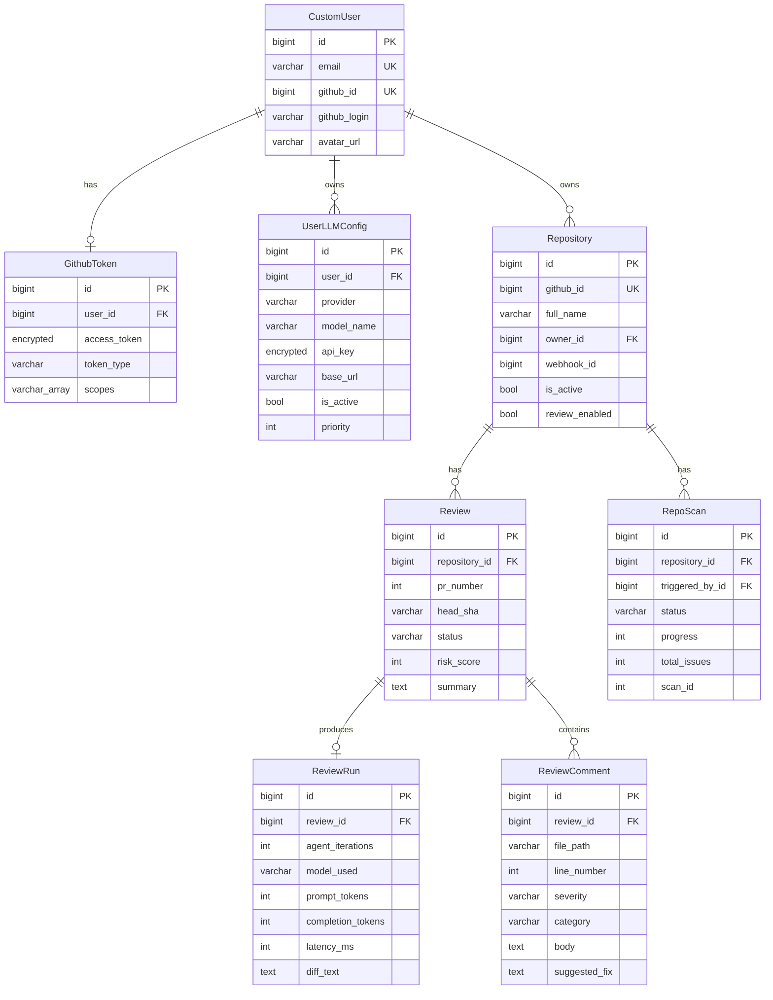
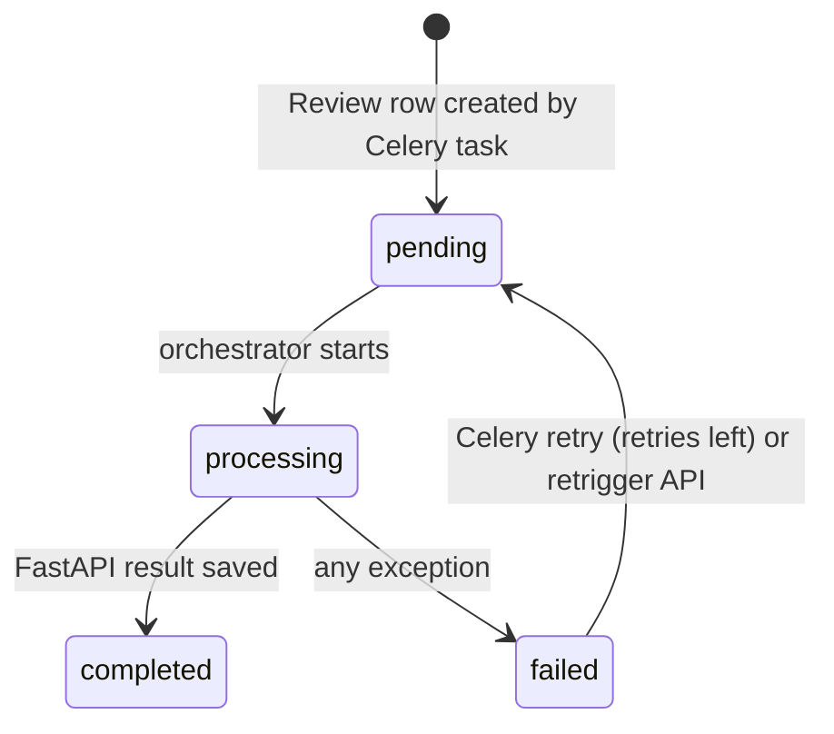

# System Architecture

## Table of Contents

1. [System Overview](#1-system-overview)
2. [Service Inventory](#2-service-inventory)
3. [Network Topology](#3-network-topology)
4. [End-to-End PR Review Flow](#4-end-to-end-pr-review-flow)
5. [AI Review Pipeline](#5-ai-review-pipeline)
6. [Authentication and Authorization](#6-authentication-and-authorization)
7. [GitHub Integration](#7-github-integration)
8. [Data Model](#8-data-model)
9. [Reliability and Failure Handling](#9-reliability-and-failure-handling)
10. [Observability](#10-observability)
11. [Security Model](#11-security-model)
12. [Architectural Decisions](#12-architectural-decisions)

---

## 1. System Overview

DevMind is a monorepo with two backend processes and a React frontend:

- **Django** (`backend/django`) handles GitHub OAuth, users, repositories, webhook ingestion, review orchestration (in Celery tasks), the BYOK settings API and posting comments to GitHub. It uses the Django ORM, DRF, SimpleJWT and Celery. Channels consumers are defined in `realtime/` but are not currently served (see [WebSocket status](#websocket-status)).
- **FastAPI** (`backend/fastapi`) runs the AI work: diff parsing, embeddings and pgvector similarity search, prompt building, the LangGraph review agent and the multi-provider LLM client. It also runs a regex-based full-repository scan.
- **Frontend** (`frontend`) is a React + Vite single-page app. It talks only to Django (`/api/v1`) and never calls FastAPI.

Celery workers call FastAPI over HTTP with a shared secret (`X-Internal-Secret`), and FastAPI calls Django's internal BYOK endpoint the same way. In `docker-compose.yml` FastAPI's port 8001 is published to the host, and Nginx proxies `/fastapi-metrics` to it. FastAPI's `/health`, `/metrics` and `/docs` are unauthenticated. The routes that do work (`/review/*`, `/embeddings/*`, `/scan/*`) reject requests without the secret with 403.

---

## 2. Service Inventory

Services defined in `docker-compose.yml`:

| Service | Image / build | Host port | Role |
|---|---|---|---|
| `nginx` | `./nginx` | 80 | Reverse proxy: `/metrics` and `/` to Django, `/fastapi-metrics` to FastAPI |
| `django` | `backend/django` (dev target, `runserver`) | 8000 | REST API, OAuth, webhook receiver |
| `fastapi` | `backend/fastapi` (dev target, `uvicorn --reload`) | 8001 | AI service |
| `celery_worker` | same image as Django | - | Consumes queues `default`, `review`, `notifications` |
| `celery_beat` | same image as Django | - | Beat with `django_celery_beat` DatabaseScheduler |
| `flower` | `mher/flower:2.0` | 5555 | Celery monitor UI |
| `postgres` | `pgvector/pgvector:pg16` | 5432 | Primary datastore; pgvector extension available |
| `redis` | `redis:7-alpine` | 6379 | Cache, channel layer, Celery broker/results, LLM rate limiter |
| `kafka` | `apache/kafka:3.7.0` (KRaft) | 9092, 9093 | Event topics `devmind.pr.opened`, `devmind.review.completed` |
| `prometheus` | `prom/prometheus:latest` | 9090 | Scrapes Django and FastAPI via Nginx; 15-day retention |
| `grafana` | `grafana/grafana:latest` | 3000 | Provisioned Prometheus datasource and `devmind-overview` dashboard |

The frontend isn't a compose service. Run it with `pnpm dev` (port 5173). `frontend/Dockerfile` exists but compose doesn't use it.

### Redis database allocation

Defaults from `.env.example` and `devmind/settings/base.py`:

| Redis DB | Consumer | Purpose |
|---|---|---|
| 0 (`REDIS_URL`) | Django, FastAPI | Django cache (OAuth state), Channels layer, FastAPI LLM rate-limit counters |
| 1 (`CELERY_BROKER_URL`) | Celery | Task broker |
| 2 (`CELERY_RESULT_BACKEND`) | Celery | Result backend |

Compose starts Flower with `--broker=redis://redis:6379/0`, which isn't the broker database the workers use by default (db 1).

---

## 3. Network Topology

```
Host / internet
    |
    +-- :80   Nginx
    |          location /metrics          -> django:8000/metrics
    |          location /fastapi-metrics  -> fastapi:8001/metrics
    |          location /health/          -> django:8000
    |          location /                 -> django:8000
    +-- :8000 Django   (published directly)
    +-- :8001 FastAPI  (published directly)
    +-- :5173 Vite dev server (outside compose) -> proxies /api and /ws to localhost:8000

Docker network (internal calls)
    Celery worker -> FastAPI  :8001/review/analyze, /scan/full   (X-Internal-Secret)
    FastAPI       -> Django   :8000/api/v1/auth/internal/llm-configs/ (X-Internal-Secret)
    FastAPI       -> Postgres :5432  (asyncpg, pgvector)
    FastAPI       -> Redis    :6379/0 (rate limiter)
    Django/Celery -> Postgres :5432, Redis, Kafka :9092
    Celery worker -> GitHub API (diff fetch, comment posting, repo sync, webhook install)
```

FastAPI's CORS middleware allows only `http://localhost:8000`. That stops browsers on other origins from calling it, but it isn't access control. Access control comes from the internal secret.

---

## 4. End-to-End PR Review Flow

### Trigger: GitHub webhook



On each status change, the orchestrator also calls `channel_layer.group_send` (group `review_<id>`) and, when Supabase is configured, pushes the status there. Both are best-effort.

### Idempotency

`repositories.trigger_review` looks for an existing `Review` with the same repository, PR number and head SHA. If one exists, it doesn't create another. It re-dispatches the review task only when the existing review is `pending` or `failed`.

### Trigger: manual retrigger

`POST /api/v1/reviews/<id>/retrigger/` is available to the repository owner and only when the review is `pending` or `failed`. A review in `processing` returns 409, and a `completed` review returns 400. The view resets the review to `pending`, clears the risk score, summary and completion time, and queues `trigger_review_task`.

There is no API route for creating a review by hand. `GET /api/v1/reviews/` is read-only. (`ReviewCreateView` exists in `apps/reviews/views.py` and returns 405, but it isn't routed.)

---

## 5. AI Review Pipeline

### LangGraph agent: 7-node StateGraph

Defined in `backend/fastapi/agents/review_agent.py`:



**Parallel branches.** The three analyzer nodes write to `security_comments`, `quality_comments` and `test_comments`. These fields are annotated with the `_extend_list` reducer in `agents/states.py`, so results accumulate across branches and across retry passes. `synthesize` then deduplicates them.

**`generate_fixes` makes no LLM call.** It collects the `suggested_fix` the analyzers already returned for `critical` and `error` comments.

**Confidence score** (in `format_output`):

```
diff_lines <= 10        -> confidence = 1.0
no findings             -> confidence = 0.0
otherwise               -> confidence = min(1.0, findings / max(1, diff_lines // 50))
```

If confidence is below `CONFIDENCE_THRESHOLD = 0.7` and fewer than `MAX_ITERATIONS = 3` passes have run, the graph returns to `fetch_conventions`.

**LLM response parsing** (`_parse_llm_comments`):

1. Strip markdown code fences, then `json.loads`. This handles a bare array or an object that wraps an array.
2. If that fails, extract the outermost `[...]` and parse that.

Each item is validated against `_LLMCommentSchema` (Pydantic), and unknown severities are normalized.

**Risk score** (`routers/review.py`): each comment adds critical 40, error 25, warning 10 or info 2. The total is capped at 100.

### Retrieval (RAG) steps in `POST /review/analyze`

```
parse_diff(diff)                       -> DiffChunk[] (file, language, added/removed/context lines)
for up to 20 chunks:
    store_code_embedding(...)          -> Google text-embedding-004, task_type RETRIEVAL_DOCUMENT,
                                          768 dims, deduplicated by sha256 of the chunk text
search_similar(diff[:2000], repo, top_k=5, threshold=0.6)
                                       -> task_type RETRIEVAL_QUERY, ordered by pgvector cosine distance
build_review_prompt(...)               -> 8192-token budget (tiktoken cl100k_base); diff first,
                                          then similar patterns, quality patterns, past reviews, conventions
run_review_agent(...)
```

The handler runs these steps inside a `try`. A failure in embedding or search is logged as `review.rag_context_partial`, and the review continues without similar-code context. After the response is built, a background task also stores an embedding of the first 1000 characters of the diff.

Embeddings are cached in process by an LRU cache (`_BoundedCache`, max 1000 entries) keyed by `sha256(f"{task_type}:{text}")`.

**Setup gap:** no migration or startup hook creates the `vector` extension or the `code_embeddings` / `review_embeddings` tables (`models/embeddings.py` defines them; nothing calls `create_all`). On a fresh database the retrieval steps fail and get logged, and reviews run without retrieved context.

### LLM provider failover



- A server provider is included only if its key (`GOOGLE_AI_API_KEY`, `GROQ_API_KEY`, `GITHUB_TOKEN`) is set. There is no server-side OpenAI provider; OpenAI is available only as a user BYOK provider.
- BYOK providers are mapped to an OpenAI-compatible base URL: `openai`, `groq`, `mistral`, `google_vertex`, or `custom` with an explicit URL. `anthropic` isn't mapped, so Anthropic configs are skipped.
- `LLM_FAILOVER_ENABLED=False` uses only the first provider in the chain.

**Rate limiting** (`services/rate_limiter.py`): a fixed one-minute window per provider, using the Redis key `ratelimit:{provider}:{minute}` with atomic `INCR` and a 60-second expiry. Default limits are Google 15 RPM, Groq 30 and GitHub Models 150; BYOK providers get 30. When a window is full, the call **sleeps until the next minute** rather than failing over. If Redis is unavailable, the limiter lets the request through.

---

## 6. Authentication and Authorization

### GitHub OAuth flow



The state token comes from `secrets.token_urlsafe(32)` (`apps/accounts/oauth.py`). The redirect target is the callback URL configured on the GitHub OAuth App; Django doesn't send a `redirect_uri`.

### JWT configuration (`SIMPLE_JWT` in `devmind/settings/base.py`)

| Parameter | Value |
|---|---|
| Algorithm | `JWT_ALGORITHM`, default HS256 |
| Signing key | `JWT_SECRET_KEY` |
| Access lifetime | `JWT_ACCESS_TOKEN_EXPIRE_MINUTES`, default 60 |
| Refresh lifetime | `JWT_REFRESH_TOKEN_EXPIRE_DAYS`, default 30 |
| Rotation / blacklist | `ROTATE_REFRESH_TOKENS` and `BLACKLIST_AFTER_ROTATION` both on |

The frontend stores both tokens in `localStorage` and refreshes on 401 (`frontend/src/api/client.ts`).

### WebSocket status

`devmind/asgi.py` builds a Channels `ProtocolTypeRouter` with `JwtQueryAuthMiddleware`, which reads `?token=` from the URL. `realtime/routing.py` maps `ws/reviews/<id>/` and `ws/notifications/`. The consumers are covered by `realtime/tests/test_consumers.py`.

None of this is served today:

- `ASGI_APPLICATION` isn't set and `daphne` isn't in `INSTALLED_APPS`, so `runserver` serves HTTP only (a WebSocket upgrade to `/ws/reviews/1/` returns 404).
- The production image runs `gunicorn devmind.wsgi:application`.
- `nginx/nginx.conf` has no WebSocket upgrade block.

Separately, `ReviewStatusConsumer` accepts any authenticated user for any review ID without checking ownership. That needs fixing before the endpoint is enabled.

### Service-to-service authentication

- Header: `X-Internal-Secret: <FASTAPI_INTERNAL_SECRET>`
- FastAPI checks it with `hmac.compare_digest` (`core/security.py`) on the `/review`, `/embeddings` and `/scan` routers. An empty secret on either side counts as a failure (403).
- Django's `InternalLLMConfigListView` applies the same check to `GET /api/v1/auth/internal/llm-configs/`. That endpoint returns decrypted BYOK keys to FastAPI.

### DRF defaults

- Authentication: JWT only. Default permission: `IsAuthenticated`.
- Throttling in `base.py`: anonymous 100/hour, authenticated `API_GLOBAL_RATE_LIMIT`/hour (default 1000). The development and test settings turn throttling off.
- Pagination: `PageNumberPagination`, page size 20.

---

## 7. GitHub Integration

### Webhook handling

Endpoint: `POST /api/v1/webhooks/github/`. It has no JWT authentication (`authentication_classes = []`) and requires an HMAC signature (`apps/repositories/webhooks.py`).

```python
configured_secret = settings.GITHUB_WEBHOOK_SECRET or ""
if not configured_secret:
    raise WebhookVerificationError(...)          # -> 403
expected = "sha256=" + hmac.new(secret, request.body, hashlib.sha256).hexdigest()
if not hmac.compare_digest(expected, signature_header):
    raise WebhookVerificationError(...)          # -> 403
```

| Event | Action | Behavior |
|---|---|---|
| `pull_request` | `opened`, `synchronize`, `reopened` | Repo must be known, active and `review_enabled`; enqueue `repositories.trigger_review`, produce `devmind.pr.opened` |
| `pull_request` | anything else | Ignored |
| `ping` | - | Logged |
| any other event | - | Ignored |

### Webhook lifecycle



`install_webhook_task` skips repositories that already have a `webhook_id`. It retries GitHub rate-limit errors after one hour (`RATE_LIMIT_RETRY_COUNTDOWN = 3600`) and other failures up to 5 times. `remove_webhook_task` exists, but only the Django admin calls it; there is no API route for disconnecting a repository.

### Comment posting

`GitHubPoster` (`apps/reviews/services/github_poster.py`):

- Comments with `line_number > 0` are posted inline (`line`, `side: RIGHT`), grouped by file and sent in batches of 50 per review.
- Comments without a usable line number are folded into the review body.
- If GitHub returns 422 for an inline batch, the poster retries the batch as a body-only review so the findings still appear.
- Every review is posted with `event: COMMENT`, so DevMind never approves a PR or requests changes.

---

## 8. Data Model

### Django entities



`apps/organizations` adds organizations, memberships and invites. They aren't shown here.

### Indexes

| Table | Index |
|---|---|
| `reviews_review` | `(repository, pr_number)`, `(completed_at)`, `status` |
| `reviews_reviewcomment` | `(review, severity)`, `(review, file_path, line_number)` |
| Repository table | `(owner, is_active)`, `(github_id)`, `full_name`, `is_active` |

### FastAPI tables (SQLAlchemy, `models/embeddings.py`)

| Table | Key columns |
|---|---|
| `code_embeddings` | `repo_full_name`, `file_path`, `chunk_text`, `language`, `chunk_type`, `embedding Vector(768)`, `sha256` unique |
| `review_embeddings` | `review_id` unique, `user_id`, `code_hash`, `feedback_text`, `embedding Vector(768)`, `extra_data` JSONB |

These have B-tree indexes on `repo_full_name`, `language` and `user_id`. There is no vector (HNSW or IVFFlat) index, so similarity search scans the table sequentially. As noted in section 5, nothing in the repo creates these tables yet.

### Enum values

- `Review.status`: `pending`, `processing`, `completed`, `failed`
- `ReviewComment.severity`: `info`, `warning`, `error`, `critical`
- `ReviewComment.category`: `security`, `quality`, `tests`, `style`, `performance`
- `UserLLMConfig.provider`: `openai`, `anthropic`, `google_vertex`, `mistral`, `custom`
- `RepoScan.status`: `queued`, `scanning`, `completed`, `failed`

---

## 9. Reliability and Failure Handling

### Retry strategy

| Layer | Mechanism |
|---|---|
| Orchestrator to FastAPI | tenacity: 3 attempts, exponential backoff 5-60s, on timeout or 503 only. 403, 429 and other errors fail immediately. |
| `apps.reviews.tasks.trigger_review_task` | Celery `max_retries=3`, 60s delay. Resets a `failed` review to `pending` before each retry; on the final attempt it stays `failed`. |
| `post_github_comments_task` | Celery `max_retries=3`, independent of the review task |
| `repositories.trigger_review` | Celery `max_retries=3`, `acks_late=True` |
| `repositories.install_webhook` | Celery `max_retries=5`; 1-hour countdown on GitHub rate limits |
| GitHub API calls in `GitHubService` | tenacity retries on transient server errors |

### Review status machine



### Graceful degradation

| Failure | Behavior |
|---|---|
| Redis unavailable (FastAPI) | Rate limiter logs and lets the request through |
| Channels push fails | Caught and logged |
| Supabase unavailable | Caught and logged; review continues |
| Kafka unavailable or `KAFKA_BOOTSTRAP_SERVERS` empty | Producer not created or produce fails; logged; review completes |
| An LLM provider fails | Next provider in the chain; all failed means FastAPI returns 429 and the review fails |
| Embedding/search fails | Logged; review runs without retrieved context |

### Celery queues

Routes from `CELERY_TASK_ROUTES` in `base.py`:

| Queue | Tasks |
|---|---|
| `review` | `repositories.trigger_review` |
| `default` | `apps.reviews.tasks.trigger_review_task`, `post_github_comments_task`, `full_repo_scan_task`, `cleanup_old_reviews`, `repositories.initial_sync`, `install_webhook`, `remove_webhook`, organization tasks; also the default for unrouted tasks |
| `notifications` | Consumed by the worker; no task is currently routed to it |

Beat uses the database scheduler. No periodic tasks are defined in code, so `cleanup_old_reviews` runs only if someone schedules it (for example, in the Django admin).

---

## 10. Observability

### Metrics endpoints

| Endpoint | Source |
|---|---|
| `/metrics` (Django, also via Nginx) | `django_prometheus` middleware and URLs |
| `/metrics` on FastAPI, `/fastapi-metrics` via Nginx | `prometheus_fastapi_instrumentator` |

`prometheus/prometheus.yml` scrapes both through `nginx:80` every 15 seconds.

Custom metrics:

- **Django** (`apps/core/metrics.py`) defines `devmind_*` counters, histograms and gauges, but no code records them.
- **FastAPI** (`core/metrics.py`): `routers/review.py` records `agent_iterations_total`, `rag_pipeline_duration_ms` and `review_errors_total`. The other FastAPI metrics aren't recorded.
- **Grafana:** the provisioned dashboard (`grafana/provisioning/dashboards/devmind-overview.json`) queries only `devmind_*` series, so its panels are empty.

### Logging

Django logs to the console with a `verbose` text formatter. Some modules use `structlog`. FastAPI configures logging in `core/logging.py` at startup.

### Health checks

| Endpoint | Checks | Response |
|---|---|---|
| Django `GET /health/` | DB connection, Redis `PING` | Always HTTP 200; body reports `db` / `redis` as `ok` or `error` |
| FastAPI `GET /health` | `SELECT 1`, pgvector extension present, `GET /models` on each configured server provider | 503 if DB or pgvector check fails, else 200. Exception details are logged server-side and not returned. |

### Error tracking

Each service calls `sentry_sdk.init` when its DSN (`SENTRY_DSN_DJANGO` / `SENTRY_DSN_FASTAPI`) is non-empty. `traces_sample_rate` defaults to 0.1.

---

## 11. Security Model

### Trust boundaries

```
Browser -> Django                 JWT (Bearer), DRF throttling (base settings), CORS allow-list
GitHub  -> Django webhook         HMAC-SHA256; rejected when no secret is configured
Celery  -> FastAPI work routes    X-Internal-Secret, constant-time compare
FastAPI -> Django BYOK endpoint   X-Internal-Secret, constant-time compare
User-supplied BYOK base_url      https + public-address check in Django on save and before
                                  the key test; FastAPI later calls the stored URL
```

### Encryption at rest

| Data | Mechanism |
|---|---|
| `GithubToken.access_token` | `EncryptedCharField`: Fernet with a key derived from `SECRET_KEY` (HKDF-SHA256, fixed salt) |
| `UserLLMConfig.api_key` | Same field type and key |

There's no separate encryption-key variable. Changing `DJANGO_SECRET_KEY` makes existing tokens and API keys impossible to decrypt.

### Where secrets leave the server

- `GET /api/v1/auth/github/token/` returns the authenticated user's decrypted GitHub token to the browser.
- `GET /api/v1/auth/internal/llm-configs/` returns decrypted BYOK keys to FastAPI (secret-protected).

### Input validation

- The webhook signature is verified before the payload is dispatched.
- BYOK `base_url` is validated in the serializer and again right before the key-test request (`validate_public_https_url`). It must be https, and every resolved address must be public. DNS rebinding between check and use isn't covered, as the code comments say.
- `ReviewOrchestrator._save_results` maps unknown categories to `quality` and unknown severities to `info` before inserting.
- LLM output is validated with Pydantic before it reaches the response model.

### BYOK key validation

When a user creates a config, `_validate_provider_key` sends `GET <base>/models` to the provider, and keys that fail are rejected. The test settings skip this (`SKIP_LLM_KEY_VALIDATION=True`).

---

## 12. Architectural Decisions

### Two backends (Django + FastAPI)

**What:** Django owns the user-facing API and data. FastAPI owns the LLM and vector work.

**Why:** Django provides the ORM, admin, DRF and Celery integration needed for CRUD, OAuth and background jobs. The AI path is I/O-bound, with concurrent LLM calls and async database queries, which suits an async framework with Pydantic models.

**Tradeoffs:** two dependency sets and images, a shared secret to keep in sync, and an HTTP hop between them.

### Celery for review jobs

**What:** Webhook handling only queues work; reviews run in Celery tasks.

**Why:** A review involves several LLM calls and can take much longer than a webhook delivery should wait. Queuing lets the webhook return immediately and keeps slow reviews from tying up web workers.

**Tradeoffs:** another moving part (broker, workers, beat), and results reach the UI only when it fetches them.

### LangGraph for the review agent

**What:** The review is a `StateGraph` with typed state, parallel analyzer branches and a conditional retry edge.

**Why:** The graph makes the pipeline explicit, so each node can be tested in isolation, and adding an analyzer means adding a node and two edges.

**Tradeoffs:** Parallel branches need explicit reducers. Without `_extend_list`, results from all but one analyzer are lost.

### pgvector instead of a dedicated vector database

**What:** Embeddings live in the same PostgreSQL instance as everything else.

**Why:** It avoids a second datastore to run, back up and secure. The interface is contained in `services/vector_store.py`.

**Tradeoffs:** shared connection pool; no vector index is defined yet, so search cost grows linearly with stored chunks.

### Redis-backed LLM rate limiter

**What:** Per-provider RPM counters live in Redis rather than in process memory.

**Why:** Each uvicorn worker has its own memory, so in-process counters would let every worker use the full provider limit.

**Tradeoffs:** If Redis fails, rate limiting turns off. Over-limit calls sleep until the next minute instead of trying another provider.

### Kafka for domain events

**What:** Django produces `devmind.pr.opened` and `devmind.review.completed`.

**Why:** Other services can consume these events later without changes to the review pipeline.

**Tradeoffs:** Kafka is heavy to run for two topics with no consumers in this repo yet. Producing is fire-and-forget, so events can be lost when Kafka is down.

### Storing the diff in `ReviewRun.diff_text`

**What:** The diff sent to FastAPI is saved with the review run.

**Why:** The review page can render the diff without calling GitHub again with the user's token.

**Tradeoffs:** unbounded `TextField`, no compression or size cap.
